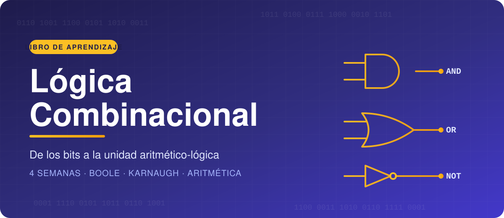
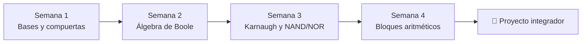

<div align="center">




</div>

---

## 📖 Contenido

| Semana | Tema | Capítulo |
|:------:|------|----------|
| 1 | Sistemas numéricos, aritmética binaria, códigos y compuertas lógicas | [Abrir](docs/semana-1.md) |
| 2 | Álgebra de Boole, De Morgan, minitérminos y maxitérminos | [Abrir](docs/semana-2.md) |
| 3 | Mapas de Karnaugh, condiciones indiferentes, universalidad NAND/NOR | [Abrir](docs/semana-3.md) |
| 4 | Semisumador, sumador completo, sumador paralelo, resta y comparador | [Abrir](docs/semana-4.md) |
| — | Glosario de términos | [Abrir](docs/glosario.md) |

## 🗺️ Ruta de aprendizaje



## 🧱 Estructura del repositorio

```
libro-logica-combinacional/
├── README.md
├── mkdocs.yml          # (opcional) sitio web con tema Material
├── .gitignore
└── docs/
    ├── portada.md
    ├── index.md
    ├── assets/portada.svg
    ├── semana-1.md
    ├── semana-2.md
    ├── semana-3.md
    ├── semana-4.md
    └── glosario.md
```

## 🌐 Ver como sitio web (opcional)

```bash
pip install mkdocs-material
mkdocs serve        # vista previa en http://127.0.0.1:8000
```

## 🤖 Declaración de uso de inteligencia artificial

> *Completa esta sección según la política de tu curso: indica qué herramientas de IA usaste, para qué partes y cómo verificaste el contenido.*

## 👤 Autor

- **Nombre:** _tu nombre_
- **Curso:** _nombre de la asignatura_
- **Fecha:** _fecha_
