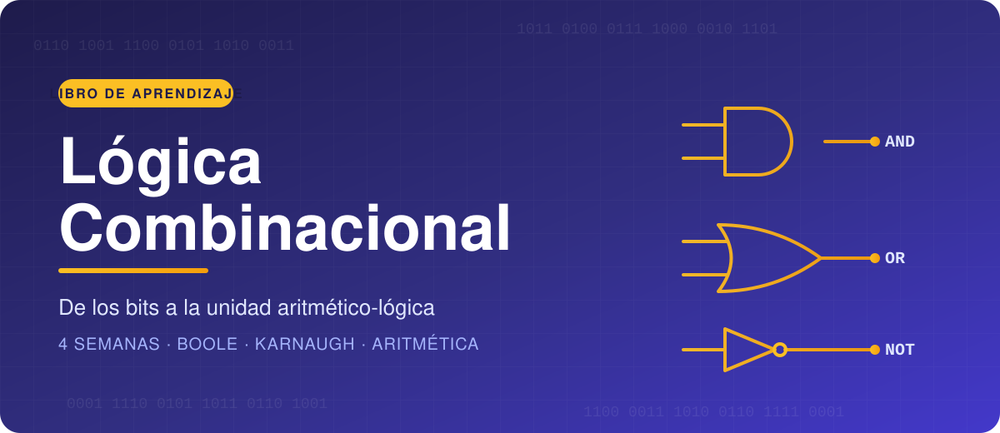

  

## LÓGICA COMBINACIONAL
### Libro de aprendizaje · Cuatro semanas

 

| | |
|:--|:--|
| **Institución** | _Nombre de la institución_ |
| **Carrera / Programa** | _Nombre de la carrera_ |
| **Asignatura** | _Nombre de la asignatura_ |
| **Docente** | _Nombre del docente_ |
| **Autor(es)** | _Nombre(s) del estudiante(s)_ |
| **Periodo académico** | _Periodo_ |
| **Ciudad y fecha** | _Ciudad, fecha_ |

 

*De los bits a la unidad aritmético-lógica*

---
