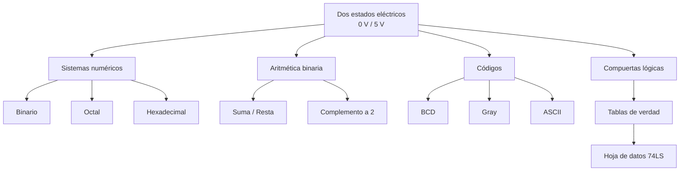

# 📘 Semana 1 · Sistemas numéricos, códigos y compuertas

## 🎯 Objetivos

- Explicar por qué un computador representa toda la información con **dos estados eléctricos**.
- Convertir entre los sistemas **binario, octal, decimal y hexadecimal**.
- Realizar sumas y restas binarias y usar el **complemento a dos**.
- Reconocer los códigos **BCD, Gray y ASCII**.
- Describir las compuertas **AND, OR, NOT, NAND, NOR, XOR y XNOR** y leer su tabla de verdad en la hoja de datos de un circuito integrado **74LS**.

## 🗺️ Mapa conceptual



---

## 1. ¿Por qué un computador usa dos estados?

Un circuito electrónico distingue con mucha fiabilidad dos niveles de voltaje: **bajo (0)** y **alto (1)**. Distinguir diez niveles (como en decimal) sería frágil ante el ruido. Por eso todo —números, texto, imágenes, sonido— se codifica como **bits**.

| Nivel lógico | Voltaje típico (familia TTL/74LS) |
|:--:|:--:|
| `0` (bajo) | 0 V a 0,8 V |
| `1` (alto) | 2,0 V a 5 V |

## 2. Sistemas numéricos

| Sistema | Base | Símbolos |
|---|:--:|---|
| Binario | 2 | 0, 1 |
| Octal | 8 | 0–7 |
| Decimal | 10 | 0–9 |
| Hexadecimal | 16 | 0–9, A–F |

### Conversión decimal → binario (divisiones sucesivas)

**Ejemplo:** convertir 45₁₀.

| División | Cociente | Residuo |
|---|:--:|:--:|
| 45 ÷ 2 | 22 | **1** |
| 22 ÷ 2 | 11 | **0** |
| 11 ÷ 2 | 5 | **1** |
| 5 ÷ 2 | 2 | **1** |
| 2 ÷ 2 | 1 | **0** |
| 1 ÷ 2 | 0 | **1** |

Se leen los residuos de abajo hacia arriba: **45₁₀ = 101101₂**.

### Binario ↔ octal ↔ hexadecimal (agrupación)

- **Octal:** grupos de 3 bits → `101 101` = **55₈**
- **Hexadecimal:** grupos de 4 bits → `0010 1101` = **2D₁₆**

### Binario → decimal (pesos)

`101101₂ = 1·32 + 0·16 + 1·8 + 1·4 + 0·2 + 1·1 = 45₁₀`

## 3. Aritmética binaria

**Reglas de la suma:** `0+0=0`, `0+1=1`, `1+0=1`, `1+1=10` (escribo 0, llevo 1).

```
  1 0 1 1     (11)
+ 0 1 1 0     ( 6)
---------
1 0 0 0 1     (17)
```

### Complemento a dos

Sirve para representar **números negativos** y convertir la resta en suma.

**Procedimiento:** invertir todos los bits y sumar 1.

**Ejemplo (8 bits): −5**

1. 5 = `0000 0101`
2. Invertir → `1111 1010`
3. Sumar 1 → `1111 1011` = **−5** (en hex: `FB`)

!!! note "Rango con n bits"
    En complemento a dos con *n* bits se representan los valores de **−2ⁿ⁻¹** a **2ⁿ⁻¹ − 1**. Con 8 bits: de −128 a +127.

## 4. Códigos

### BCD (decimal codificado en binario)
Cada dígito decimal se codifica con 4 bits.

| Decimal | BCD |
|:--:|:--:|
| 0 | 0000 |
| 1 | 0001 |
| 2 | 0010 |
| 3 | 0011 |
| 4 | 0100 |
| 5 | 0101 |
| 6 | 0110 |
| 7 | 0111 |
| 8 | 1000 |
| 9 | 1001 |

Ejemplo: **45₁₀ = 0100 0101** en BCD (no es lo mismo que 45 en binario puro).

### Código Gray
Entre dos valores consecutivos **cambia un solo bit**. Es útil en encoders y en mapas de Karnaugh.

**Binario → Gray:** el bit más significativo se copia; cada bit siguiente es `bᵢ ⊕ bᵢ₊₁`.

| Decimal | Binario | Gray |
|:--:|:--:|:--:|
| 0 | 000 | 000 |
| 1 | 001 | 001 |
| 2 | 010 | 011 |
| 3 | 011 | 010 |
| 4 | 100 | 110 |
| 5 | 101 | 111 |
| 6 | 110 | 101 |
| 7 | 111 | 100 |

### ASCII
Codifica caracteres con 7 bits (usualmente almacenados en 8).

| Carácter | Decimal | Hex | Binario |
|:--:|:--:|:--:|:--:|
| `0` | 48 | 30 | 0011 0000 |
| `A` | 65 | 41 | 0100 0001 |
| `a` | 97 | 61 | 0110 0001 |

## 5. Compuertas lógicas

| Compuerta | Expresión | Descripción |
|---|:--:|---|
| NOT | `A'` o `Ā` | Invierte la entrada |
| AND | `A·B` | 1 solo si **todas** las entradas son 1 |
| OR | `A+B` | 1 si **al menos una** entrada es 1 |
| NAND | `(A·B)'` | AND negada |
| NOR | `(A+B)'` | OR negada |
| XOR | `A⊕B` | 1 si las entradas **son distintas** |
| XNOR | `(A⊕B)'` | 1 si las entradas **son iguales** |

### Tabla de verdad conjunta

| A | B | AND | OR | NAND | NOR | XOR | XNOR |
|:-:|:-:|:---:|:--:|:----:|:---:|:---:|:----:|
| 0 | 0 | 0 | 0 | 1 | 1 | 0 | 1 |
| 0 | 1 | 0 | 1 | 1 | 0 | 1 | 0 |
| 1 | 0 | 0 | 1 | 1 | 0 | 1 | 0 |
| 1 | 1 | 1 | 1 | 0 | 0 | 0 | 1 |

### Circuitos integrados de la familia 74LS

| Compuerta | Circuito integrado | Contenido |
|---|:--:|---|
| NOT | 74LS04 | 6 inversores |
| AND | 74LS08 | 4 AND de 2 entradas |
| OR | 74LS32 | 4 OR de 2 entradas |
| NAND | 74LS00 | 4 NAND de 2 entradas |
| NOR | 74LS02 | 4 NOR de 2 entradas |
| XOR | 74LS86 | 4 XOR de 2 entradas |
| XNOR | 74LS266 | 4 XNOR (colector abierto) |

!!! warning "Verifica siempre en la hoja de datos"
    Antes de cablear, consulta el *datasheet* del fabricante: asignación de pines (pin 14 = Vcc, pin 7 = GND en los CI de 14 pines), niveles de voltaje y la **tabla de función** del circuito. En el 74LS02 (NOR) la distribución de pines de las compuertas es distinta a la del 74LS00 y 74LS08.

### Cómo leer la tabla de función
La hoja de datos usa **H** (nivel alto) y **L** (nivel bajo). Por ejemplo, para una NAND: entradas `H H` → salida `L`; cualquier otra combinación → `H`.

---

## 🛠️ Taller

1. Convierte **156₁₀** a binario, octal y hexadecimal.
2. Convierte **10110111₂** a decimal y a hexadecimal.
3. Suma `1101₂ + 1011₂` y comprueba en decimal.
4. Escribe **−18** en complemento a dos con 8 bits.
5. Calcula **9 − 5** en 4 bits usando complemento a dos.
6. Escribe **729₁₀** en BCD.
7. Convierte el binario `1011` a código Gray.
8. ¿Cuál es el código ASCII (decimal y binario) de `B`?
9. Construye la tabla de verdad de `F = (A ⊕ B) · C'`.
10. Busca en la hoja de datos del 74LS08 la distribución de pines y dibuja un esquema que implemente `F = A·B·C` con ese integrado.

<details>
<summary><b>✅ Ver soluciones</b></summary>

1. 156 = `10011100₂` = `234₈` = `9C₁₆`
2. `10110111₂` = 128+32+16+4+2+1 = **183₁₀** = **B7₁₆**
3. `1101 + 1011 = 11000₂` → 13 + 11 = 24 ✔
4. 18 = `00010010` → invertido `11101101` → +1 → **`11101110`**
5. 9 = `1001`; 5 = `0101`; −5 = `1011`. `1001 + 1011 = 1 0100` → se descarta el acarreo → **`0100` = 4**
6. 7 → 0111, 2 → 0010, 9 → 1001: **0111 0010 1001**
7. `1011` → Gray: 1, 1⊕0=1, 0⊕1=1, 1⊕1=0 → **`1110`**
8. B = **66** = `0100 0010`
9. Tabla:

| A | B | C | A⊕B | C' | F |
|:-:|:-:|:-:|:-:|:-:|:-:|
| 0 | 0 | 0 | 0 | 1 | 0 |
| 0 | 0 | 1 | 0 | 0 | 0 |
| 0 | 1 | 0 | 1 | 1 | **1** |
| 0 | 1 | 1 | 1 | 0 | 0 |
| 1 | 0 | 0 | 1 | 1 | **1** |
| 1 | 0 | 1 | 1 | 0 | 0 |
| 1 | 1 | 0 | 0 | 1 | 0 |
| 1 | 1 | 1 | 0 | 0 | 0 |

10. Dos compuertas AND de 2 entradas en cascada: `X = A·B`, `F = X·C`.

</details>

## 📝 Autoevaluación

- [ ] Sé explicar por qué se usan dos estados eléctricos.
- [ ] Convierto entre binario, octal, decimal y hexadecimal sin ayuda.
- [ ] Obtengo el complemento a dos de un número.
- [ ] Distingo BCD, Gray y ASCII.
- [ ] Reconozco las siete compuertas y sus tablas de verdad.
- [ ] Sé leer una hoja de datos 74LS.
