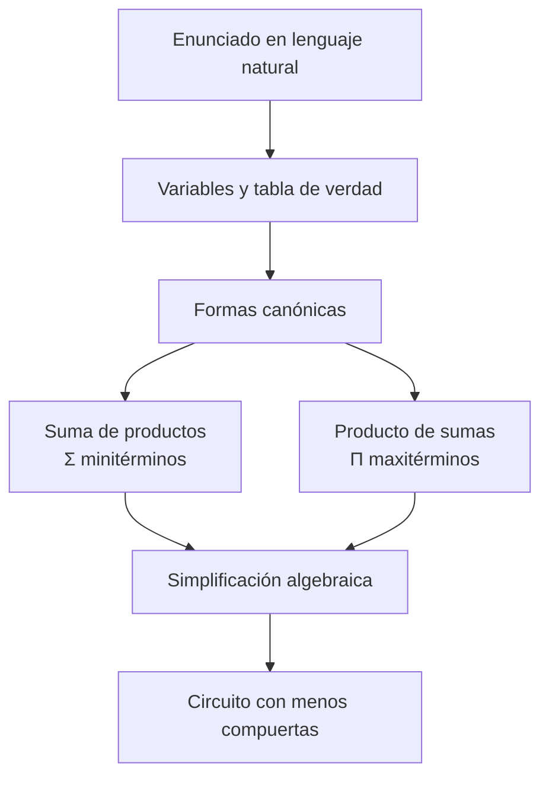

# 📗 Semana 2 · Álgebra de Boole y formas canónicas

## 🎯 Objetivos

- Entender que **un circuito y una expresión matemática son la misma cosa escrita de dos maneras**.
- Traducir un requerimiento en lenguaje natural a una **especificación lógica sin ambigüedad**.
- Aplicar los postulados, teoremas y las **leyes de De Morgan**.
- Obtener las formas canónicas **suma de productos (SOP)** y **producto de sumas (POS)** con minitérminos y maxitérminos.
- Simplificar algebraicamente y **contar las compuertas** que requiere cada versión.

## 🗺️ Mapa conceptual



---

## 1. Postulados y teoremas del álgebra de Boole

| Nombre | Forma con AND | Forma con OR |
|---|:--:|:--:|
| Identidad | `A·1 = A` | `A+0 = A` |
| Elemento nulo | `A·0 = 0` | `A+1 = 1` |
| Idempotencia | `A·A = A` | `A+A = A` |
| Complemento | `A·A' = 0` | `A+A' = 1` |
| Involución | `(A')' = A` | |
| Conmutativa | `A·B = B·A` | `A+B = B+A` |
| Asociativa | `(A·B)·C = A·(B·C)` | `(A+B)+C = A+(B+C)` |
| Distributiva | `A·(B+C) = A·B + A·C` | `A+B·C = (A+B)·(A+C)` |
| Absorción | `A·(A+B) = A` | `A+A·B = A` |
| Adyacencia | `A·B + A·B' = A` | `(A+B)·(A+B') = A` |

!!! info "Principio de dualidad"
    Si en una identidad se intercambian AND↔OR y 0↔1, se obtiene otra identidad válida.

## 2. Leyes de De Morgan

```
(A · B)' = A' + B'
(A + B)' = A' · B'
```

**Regla práctica:** para negar una expresión, se niegan las variables y se cambian los operadores AND↔OR.

**Ejemplo:** `(A·B' + C)' = (A·B')' · C' = (A' + B) · C'`

## 3. Del enunciado a la expresión lógica

Una frase como *"suena la alarma si se activan al menos dos sensores"* se presta a ambigüedad. El método seguro:

1. Identificar las **variables de entrada** y la **salida**.
2. Asignar significado a 0 y 1.
3. Construir la **tabla de verdad**.
4. Obtener la forma canónica.

## 4. Minitérminos y maxitérminos

Para 3 variables:

| Fila | A B C | Minitérmino (mᵢ) | Maxitérmino (Mᵢ) |
|:-:|:-:|:--:|:--:|
| 0 | 0 0 0 | `A'B'C'` | `A+B+C` |
| 1 | 0 0 1 | `A'B'C` | `A+B+C'` |
| 2 | 0 1 0 | `A'BC'` | `A+B'+C` |
| 3 | 0 1 1 | `A'BC` | `A+B'+C'` |
| 4 | 1 0 0 | `AB'C'` | `A'+B+C` |
| 5 | 1 0 1 | `AB'C` | `A'+B+C'` |
| 6 | 1 1 0 | `ABC'` | `A'+B'+C` |
| 7 | 1 1 1 | `ABC` | `A'+B'+C'` |

- **Minitérmino:** producto de todas las variables; vale **1 en una sola fila**.
- **Maxitérmino:** suma de todas las variables; vale **0 en una sola fila**.

### Formas canónicas

- **Suma de productos (SOP):** `F = Σm(...)` → se suman los minitérminos de las filas donde **F = 1**.
- **Producto de sumas (POS):** `F = ΠM(...)` → se multiplican los maxitérminos de las filas donde **F = 0**.

!!! tip "¿Cuál elegir?"
    Si la función tiene **menos unos que ceros**, la SOP es más corta. Si tiene **menos ceros que unos**, conviene la POS.

## 5. Ejemplo guiado: alarma de tres sensores

**Enunciado:** la alarma `F` suena cuando **al menos dos** de los tres sensores `A`, `B`, `C` están activos (1).

| Fila | A | B | C | F |
|:-:|:-:|:-:|:-:|:-:|
| 0 | 0 | 0 | 0 | 0 |
| 1 | 0 | 0 | 1 | 0 |
| 2 | 0 | 1 | 0 | 0 |
| 3 | 0 | 1 | 1 | **1** |
| 4 | 1 | 0 | 0 | 0 |
| 5 | 1 | 0 | 1 | **1** |
| 6 | 1 | 1 | 0 | **1** |
| 7 | 1 | 1 | 1 | **1** |

**SOP canónica:**

```
F = Σm(3,5,6,7) = A'BC + AB'C + ABC' + ABC
```

**POS canónica:**

```
F = ΠM(0,1,2,4) = (A+B+C)(A+B+C')(A+B'+C)(A'+B+C)
```

### Simplificación algebraica

Sumamos `ABC` dos veces más (idempotencia: `X = X + X`) y agrupamos por adyacencia:

```
F = A'BC + AB'C + ABC' + ABC + ABC + ABC
  = (A'BC + ABC) + (AB'C + ABC) + (ABC' + ABC)
  = BC(A'+A) + AC(B'+B) + AB(C'+C)
  = BC + AC + AB
```

### Conteo de compuertas

| Versión | Compuertas |
|---|---|
| Canónica SOP | 3 NOT + 4 AND de 3 entradas + 1 OR de 4 entradas = **8** |
| Simplificada `AB+AC+BC` | 3 AND de 2 entradas + 1 OR de 3 entradas = **4** |

La versión simplificada usa **la mitad de las compuertas**, con menos costo, menos consumo y menor retardo.

---

## 🛠️ Taller

1. Demuestra con tabla de verdad que `A + A'B = A + B`.
2. Aplica De Morgan: niega `F = A'B + CD'`.
3. Simplifica `F = AB + AB'C + A'B'C`.
4. Una lámpara debe encenderse cuando **exactamente uno** de los interruptores `A`, `B`, `C` está activo. Construye la tabla, escribe la SOP y la POS canónicas.
5. Escribe `F = Σm(1,2,4,7)` y `F = ΠM(0,3,5,6)` y comprueba que son la misma función.
6. Cuenta las compuertas de la versión canónica y de la simplificada del ejercicio 3.

<details>
<summary><b>✅ Ver soluciones</b></summary>

1. Para A=0,B=0: ambos 0. A=0,B=1: `0+1=1` y `0+1=1`. A=1: ambos 1. ✔
2. `F' = (A'B)'·(CD')' = (A+B')(C'+D)`
3. `AB + AB'C + A'B'C = AB + B'C(A + A') = AB + B'C`
4. F = 1 en filas 1, 2, 4 → **SOP: Σm(1,2,4) = A'B'C + A'BC' + AB'C'**; **POS: ΠM(0,3,5,6,7)**
5. Las filas con F=1 son 1,2,4,7; las filas con F=0 son 0,3,5,6 → son complementarias, misma función. ✔ (es la función de paridad impar, `A⊕B⊕C`)
6. Original: 2 NOT (A' y B') + 3 AND + 1 OR = **6** compuertas; simplificada `AB + B'C`: 1 NOT + 2 AND + 1 OR = **4**.

</details>

## 📝 Autoevaluación

- [ ] Aplico postulados y absorción para simplificar.
- [ ] Uso De Morgan para negar expresiones.
- [ ] Paso de un enunciado a tabla de verdad sin ambigüedad.
- [ ] Escribo SOP y POS con notación Σm y ΠM.
- [ ] Sé elegir entre SOP y POS.
- [ ] Cuento las compuertas de cada versión.
