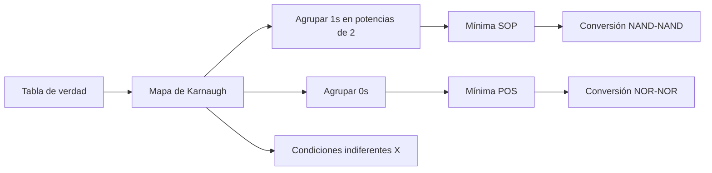
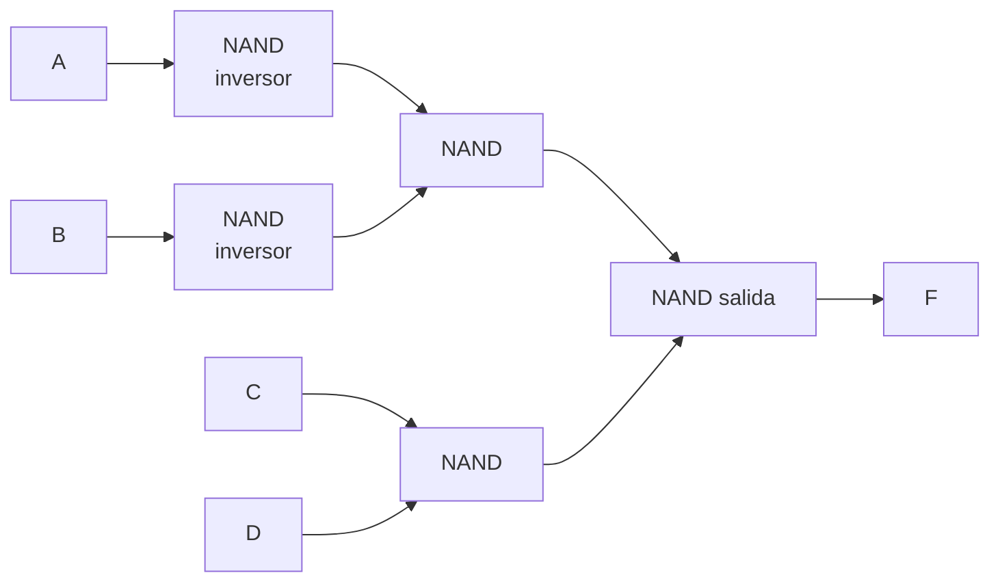

# 📙 Semana 3 · Mapas de Karnaugh y universalidad NAND/NOR

## 🎯 Objetivos

- Explicar por qué una **disposición geométrica** de la tabla de verdad hace visible la simplificación.
- Construir mapas de Karnaugh de **3 y 4 variables** y obtener la expresión mínima en **SOP** y **POS**.
- Tratar correctamente las **condiciones indiferentes** (*don't care*).
- Demostrar que toda función puede construirse **solo con NAND** o **solo con NOR**.
- Convertir un esquema AND-OR a NAND-NAND.

## 🗺️ Mapa conceptual



---

## 1. ¿Por qué un mapa?

El álgebra de Boole **no avisa cuándo se llegó a la expresión mínima**. El mapa de Karnaugh reordena la tabla de verdad de modo que **celdas vecinas difieran en un solo bit** (orden Gray: 00, 01, 11, 10). Así, dos celdas adyacentes con 1 se combinan eliminando la variable que cambia: `A·B + A·B' = A`.

## 2. Mapa de 3 variables

Ejemplo: la alarma de la semana anterior, `F = Σm(3,5,6,7)`.

| A \ BC | 00 | 01 | 11 | 10 |
|:--:|:--:|:--:|:--:|:--:|
| **0** | 0 | 0 | **1** | 0 |
| **1** | 0 | **1** | **1** | **1** |

Grupos de dos celdas: `{m3, m7}` → `BC`, `{m5, m7}` → `AC`, `{m6, m7}` → `AB`.

**`F = AB + AC + BC`** (coincide con la simplificación algebraica).

## 3. Reglas de agrupación

1. Los grupos son **rectangulares** y contienen **2ⁿ celdas** (1, 2, 4, 8, 16).
2. Cada grupo debe ser **lo más grande posible**.
3. Se debe **cubrir todos los 1** (un 1 puede pertenecer a varios grupos).
4. El mapa es **cíclico**: los bordes opuestos son adyacentes (las cuatro esquinas forman un grupo de 4).
5. Un grupo de 2ⁿ celdas elimina **n variables**.

## 4. Mapa de 4 variables y condiciones indiferentes

Las condiciones indiferentes (`X`) son combinaciones que **no ocurren** o cuya salida no importa. Se usan como 1 **solo si ayudan** a formar grupos más grandes.

**Ejemplo:** `F(A,B,C,D) = Σm(1,3,7,11,15) + d(0,2,5)`

| AB \ CD | 00 | 01 | 11 | 10 |
|:--:|:--:|:--:|:--:|:--:|
| **00** | X | **1** | **1** | X |
| **01** | 0 | X | **1** | 0 |
| **11** | 0 | 0 | **1** | 0 |
| **10** | 0 | 0 | **1** | 0 |

- Grupo 1: fila `00` completa (m0, m1, m3, m2) → `A'B'`
- Grupo 2: columna `11` completa (m3, m7, m15, m11) → `CD`
- La X de m5 **no se usa** (no ayuda a ningún grupo nuevo).

**`F = A'B' + CD`**

### Mínima en POS
Se agrupan los **0** y se obtiene `F'`; luego se aplica De Morgan para obtener `F` como producto de sumas.

## 5. Universalidad de NAND y NOR

Con solo NAND (o solo NOR) se construye **cualquier** función.

| Función | Con NAND | Con NOR |
|:--:|---|---|
| NOT `A'` | `(A·A)'` | `(A+A)'` |
| AND `A·B` | `((A·B)')'` → NAND + NOT | `(A'+B')'` → 2 NOT + NOR |
| OR `A+B` | `(A'·B')'` → 2 NOT + NAND | `((A+B)')'` → NOR + NOT |

### Procedimiento SOP → NAND-NAND
1. Obtener la mínima SOP.
2. Reemplazar cada AND y el OR final por **NAND**.
3. Las variables que aparecen solas en un producto o las negadas requieren inversores (NAND con entradas unidas).

Justificación: `F = X + Y = ((X+Y)')' = (X'·Y')'` y `X = (X')'`.

### Ejemplo: implementar `F = A'B' + CD` solo con NAND

```
F = ( (A'B')' · (CD)' )'
```

| Etapa | Compuertas NAND |
|---|---|
| Inversores de A y B | 2 |
| NAND(A', B') | 1 |
| NAND(C, D) | 1 |
| NAND de salida | 1 |
| **Total** | **5** |



!!! tip "Ventaja práctica"
    Un solo circuito integrado (74LS00) basta para implementar toda la función: se reduce el número de tipos de CI, el costo y el cableado.

---

## 🛠️ Taller

1. Minimiza con Karnaugh: `F(A,B,C) = Σm(0,1,2,5,6,7)`.
2. Minimiza `F(A,B,C,D) = Σm(0,2,8,10)` (observa las esquinas).
3. Minimiza `F(A,B,C,D) = Σm(1,5,6,7,11,12,13,15) + d(3,9)` y escribe el resultado como SOP.
4. Implementa `F = A·B + C` solo con compuertas NAND.
5. Implementa `F = (A + B)·C` solo con compuertas NOR.
6. Contrasta el resultado del ejercicio 1 con la simplificación algebraica de la misma función.

<details>
<summary><b>✅ Ver soluciones</b></summary>

1. Hay dos formas mínimas equivalentes (agrupación cíclica): `F = A'B' + BC' + AC` **o** `F = A'C' + B'C + AB`. Ambas tienen 3 términos de 2 literales.
2. Las cuatro esquinas forman un grupo: **`F = B'D'`**.
3. Mapa (filas AB, columnas CD): usando la X de m3 y m9 se forma el grupo de la fila de `D=1` completa y quedan dos grupos de 2: **`F = D + A'BC + ABC'`**. (El grupo `BD` es redundante.)
4. `F = ((AB)' · C')'` → 1 NAND(A,B), 1 inversor de C (NAND con entradas unidas) y 1 NAND de salida = **3 NAND**.
5. `F = ((A+B)' + C')'` → NOR(A,B), inversor de C (NOR con entradas unidas) y NOR de salida = **3 NOR**.
6. `F = Σm(0,1,2,5,6,7)`: algebraicamente `A'B'+A'C'+B'C+BC'+AC+AB` se reduce, eligiendo un conjunto sin redundancias, a cualquiera de las dos mínimas del ejercicio 1.

</details>

## 🚀 Lanzamiento del proyecto integrador

Esta semana arranca el **proyecto integrador de saberes**:

| Elemento | Detalle |
|---|---|
| Producto | Definido en la presentación del docente |
| Guía y rúbrica | Se entregan esta semana |
| Equipos | Se conforman en clase |
| Roles técnicos | **Rotativos** entre los integrantes |

!!! note "Sugerencia de roles"
    Diseñador lógico · Montaje/cableado · Documentación · Pruebas y verificación. Rótenlos en cada sesión.

## 📝 Autoevaluación

- [ ] Construyo mapas de 3 y 4 variables.
- [ ] Agrupo correctamente (potencias de 2, bordes cíclicos).
- [ ] Uso las condiciones indiferentes de forma estratégica.
- [ ] Obtengo mínimas en SOP y POS.
- [ ] Demuestro la universalidad de NAND y NOR.
- [ ] Convierto un esquema AND-OR a NAND-NAND.
