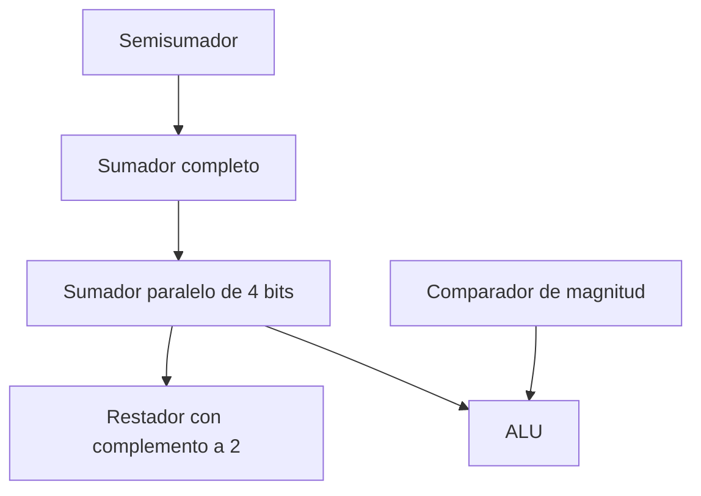
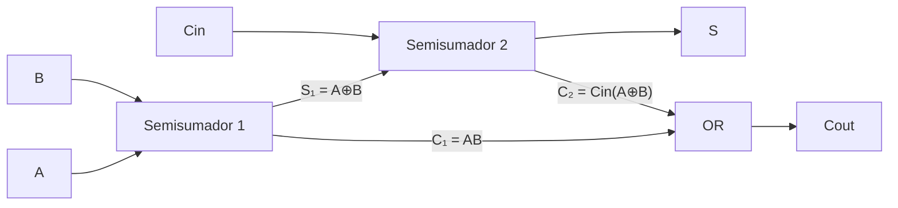
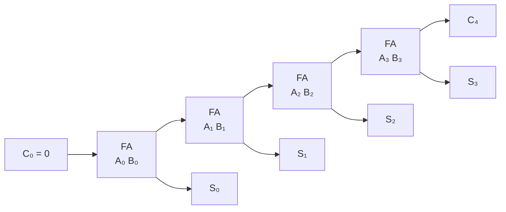
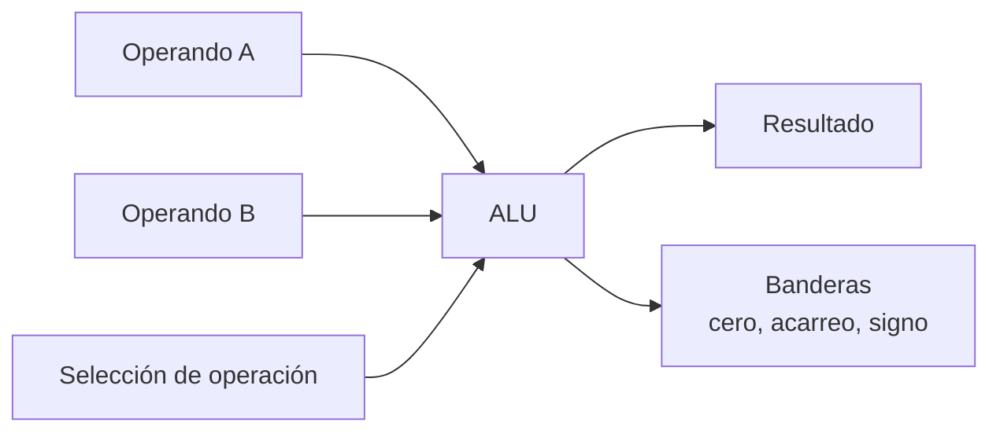

# 📕 Semana 4 · Bloques combinacionales aritméticos

## 🎯 Objetivos

- Explicar cómo un circuito **sin memoria** llega a sumar y por qué el **acarreo** es el problema central.
- Diseñar el **semisumador** y el **sumador completo** con el procedimiento ya conocido.
- Construir un **sumador paralelo de 4 bits** con propagación de acarreo.
- Realizar la **resta mediante complemento a dos**.
- Describir el **comparador de magnitud**.
- Relacionar estos bloques con la **unidad aritmético-lógica (ALU)** de un procesador.

## 🗺️ Mapa conceptual



---

## 1. Semisumador (Half Adder)

Suma **dos bits** y produce suma `S` y acarreo `C`.

| A | B | C | S |
|:-:|:-:|:-:|:-:|
| 0 | 0 | 0 | 0 |
| 0 | 1 | 0 | 1 |
| 1 | 0 | 0 | 1 |
| 1 | 1 | 1 | 0 |

```
S = A ⊕ B
C = A · B
```

Se implementa con **1 XOR + 1 AND**. Su limitación: no admite un acarreo de entrada, por lo que solo sirve para el bit menos significativo.

## 2. Sumador completo (Full Adder)

Suma **tres bits**: `A`, `B` y el acarreo de entrada `Cin`.

| A | B | Cin | Cout | S |
|:-:|:-:|:-:|:-:|:-:|
| 0 | 0 | 0 | 0 | 0 |
| 0 | 0 | 1 | 0 | 1 |
| 0 | 1 | 0 | 0 | 1 |
| 0 | 1 | 1 | 1 | 0 |
| 1 | 0 | 0 | 0 | 1 |
| 1 | 0 | 1 | 1 | 0 |
| 1 | 1 | 0 | 1 | 0 |
| 1 | 1 | 1 | 1 | 1 |

Del mapa de Karnaugh (o por álgebra):

```
S    = A ⊕ B ⊕ Cin
Cout = A·B + Cin·(A ⊕ B)
```

Se construye con **dos semisumadores y una OR**:



## 3. Sumador paralelo de 4 bits (propagación de acarreo)

Se conectan 4 sumadores completos: el `Cout` de cada etapa alimenta el `Cin` de la siguiente.



**Ejemplo:** `0110 + 0111` (6 + 7)

```
acarreos:  0 1 1 0 0
             0 1 1 0     (6)
           + 0 1 1 1     (7)
           ---------
             1 1 0 1     (13)
```

### Retardo de propagación

El bit de mayor peso debe **esperar** el acarreo de todos los anteriores. Estimación: el acarreo atraviesa aproximadamente **2 compuertas por etapa** (AND y OR).

| Parámetro | Valor de ejemplo |
|---|:--:|
| Retardo por compuerta `tₚd` | 10 ns |
| Compuertas por etapa en el camino del acarreo | 2 |
| Etapas | 4 |
| Retardo estimado del acarreo | ≈ 4 · 2 · 10 ns = **80 ns** |

!!! warning "Dato importante"
    Los valores son ilustrativos. Para un cálculo real usa el retardo de propagación indicado en la hoja de datos del CI (por ejemplo, el **74LS83**, sumador de 4 bits). El retardo crece **linealmente** con el número de bits; por eso existen sumadores con acarreo anticipado (*carry look-ahead*).

## 4. Resta por complemento a dos

```
A − B = A + B' + 1
```

Se invierte `B` (con XOR o NOT) y se pone el acarreo de entrada `C₀ = 1`.

**Ejemplo:** `7 − 3` en 4 bits

```
  0111   (7)
+ 1100   (B' = 3 invertido: 0011 → 1100)
+    1   (C₀ = 1)
-------
1 0100   → se descarta el acarreo final → 0100 = 4 ✔
```

**Sumador/restador controlado:** con una señal `M` (0 = suma, 1 = resta) y una XOR por bit: `Bᵢ ⊕ M`, y `C₀ = M`.

## 5. Comparador de magnitud

Compara dos números `A` y `B` y genera tres salidas: `A>B`, `A=B`, `A<B`.

**Comparador de 1 bit:**

| Salida | Expresión |
|:--:|:--:|
| `A = B` | `(A ⊕ B)'` (XNOR) |
| `A > B` | `A · B'` |
| `A < B` | `A' · B` |

Para varios bits se compara desde el **bit más significativo**: si son distintos, ese bit decide; si son iguales, se pasa al siguiente. Existe como CI (por ejemplo, el **74LS85**, comparador de 4 bits).

## 6. Relación con la ALU

La **unidad aritmético-lógica** de un procesador combina estos bloques:



- Sumador/restador → operaciones aritméticas.
- Compuertas AND, OR, XOR, NOT → operaciones lógicas.
- Comparador → banderas e instrucciones de comparación.

---

## 🛠️ Taller

1. Diseña un sumador completo desde su tabla de verdad hasta el esquema con compuertas (obtén `S` y `Cout` por Karnaugh).
2. Suma `1011 + 0101` con un sumador paralelo de 4 bits. ¿Qué pasa con `C₄`?
3. Calcula `9 − 6` en 4 bits por complemento a dos.
4. Analiza un sumador paralelo de 4 bits y estima su retardo si cada compuerta tiene 8 ns y el acarreo pasa por 2 compuertas por etapa.
5. Diseña un comparador de 2 bits con salidas `A>B`, `A=B` y `A<B`.
6. Dibuja un sumador/restador de 4 bits controlado por `M`.

<details>
<summary><b>✅ Ver soluciones</b></summary>

1. Mapa de `Cout` (filas A, columnas B·Cin): grupos `AB`, `A·Cin`, `B·Cin` → `Cout = AB + ACin + BCin`, equivalente a `AB + Cin(A⊕B)`. `S = A⊕B⊕Cin` (patrón de tablero, no se agrupa).
2. `1011 + 0101 = 1 0000` (11 + 5 = 16): resultado `0000` con **`C₄ = 1`** (desbordamiento sin signo: no cabe en 4 bits).
3. 9 = `1001`; 6 = `0110`; B' = `1001`; `1001 + 1001 = 1 0010`; `+ 1 = 1 0011` → se descarta el acarreo → **`0011` = 3** ✔
4. 4 etapas · 2 compuertas · 8 ns = **64 ns** (aprox.).
5. Con `A = A₁A₀`, `B = B₁B₀`: `A=B` ⇒ `(A₁⊕B₁)'·(A₀⊕B₀)'`; `A>B` ⇒ `A₁B₁' + (A₁⊕B₁)'·A₀B₀'`; `A<B` ⇒ `A₁'B₁ + (A₁⊕B₁)'·A₀'B₀`.
6. Cuatro XOR (`Bᵢ ⊕ M`) antes de los sumadores completos; `C₀ = M`.

</details>

## 📝 Autoevaluación

- [ ] Explico por qué el acarreo es el problema central de la suma.
- [ ] Diseño un semisumador y un sumador completo.
- [ ] Conecto un sumador paralelo de 4 bits.
- [ ] Resto usando complemento a dos.
- [ ] Describo el comparador de magnitud.
- [ ] Relaciono estos bloques con la ALU.

## 🏁 Cierre

Completaste el recorrido: de los **bits** a la **aritmética en hardware**. Con estas herramientas puedes abordar el proyecto integrador.
